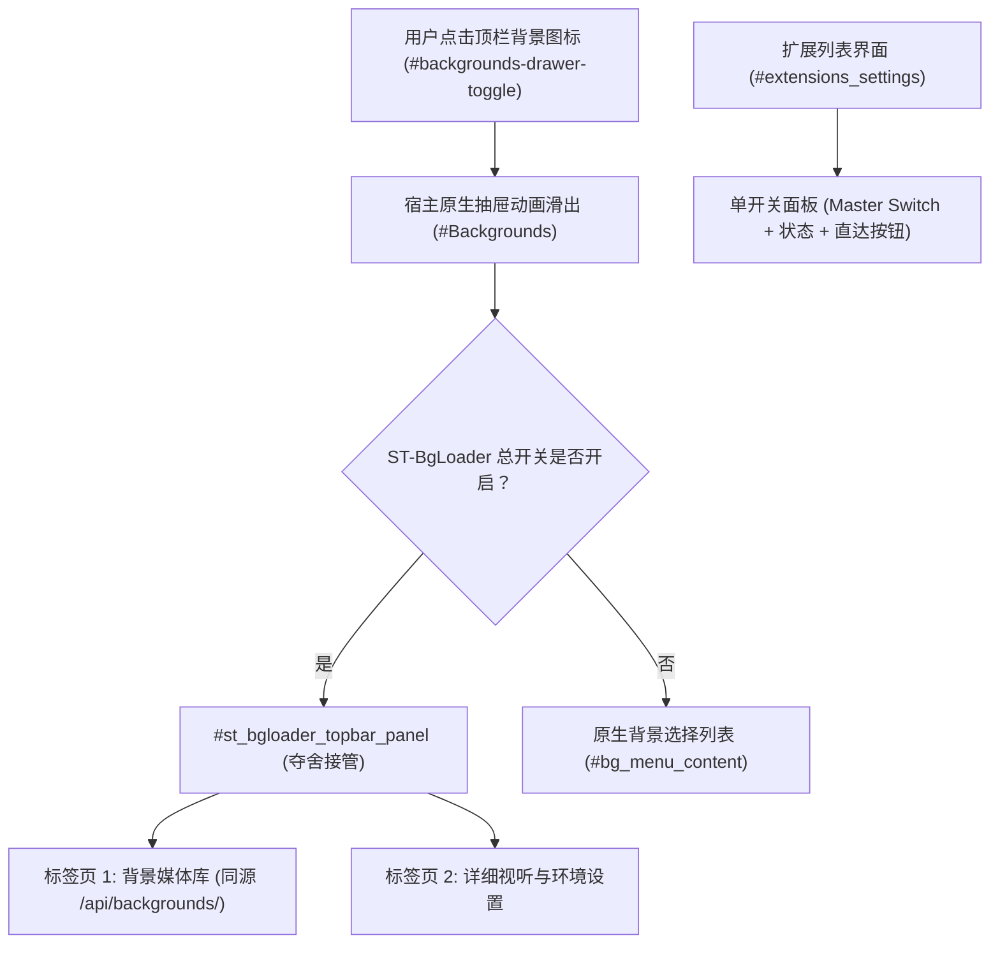

# 夺舍顶栏背景设置与单开关设置面板 — 设计文档

## 1. 架构总览

本设计将插件的交互重心从原本庞大的「扩展设置列表」完全转移到「酒馆顶栏背景抽屉（#Backgrounds）」，并在扩展列表中仅保留一个总开关。

---

## 2. 模块划分与接缝

### 2.1 宿主桥接层 (`src/bridge/HostBridge.ts`)
- **职责**：遵循 L0-9 铁律，集中封装所有针对 SillyTavern、Luker、PureTavern、TauriTavern 的环境侦测与 DOM 适配。
- **侦测指标**：
  - `isLuker`: 检测特定 Luker 标识或全局变量。
  - `isPureTavern`: 检测 PureTavern 专属属性。
  - `isTauri`: 检测 `window.__TAURI__` 或 Tauri 环境。
  - `isSillyTavern`: 默认基准。
- **抽象接口**：
  - `getTopbarBackgroundButton()`: 返回顶栏背景触发按钮元素。
  - `getBackgroundDrawer()`: 返回 `#Backgrounds` 抽屉元素。
  - `getExtensionsSettingsContainer()`: 返回 `#extensions_settings` 挂载容器。
  - `getRequestHeaders(opts)`: 统一获取 CSRF 请求头。
  - `openBackgroundDrawer()`: 编程式打开顶栏背景抽屉。

### 2.2 顶栏背景抽屉夺舍面板 (`src/ui/TopbarBackgroundDrawer.ts`)
- **挂载点**：宿主 `#Backgrounds` 内部。
- **生命周期**：
  - `mount()`: 给原生子节点添加 `.st-bg-native-hidden`（隐藏原生 `#bg-header-fixed`、`#bg_menu_content` 等），将 `#st_bgloader_topbar_panel` 注入到 `#Backgrounds`。
  - `unmount()`: 移除 `#st_bgloader_topbar_panel`，移除原生子节点的 `.st-bg-native-hidden` 类，完全还原原生抽屉。
- **UI 结构**：
  - 顶部导航栏：
    - Tab 按钮组：`[背景媒体库]` 与 `[详细设置]`。
    - 快速工具：背景图层显示/隐藏切换、重新加载/刷新按钮。
  - 内容区：
    - **Tab 1: 背景媒体库**
      - 快速上传栏（拖拽区域 + 文件选择 + URL 导入）。
      - 媒体类型筛选（全部、视频、音频、图片、网页/SVG）与搜索框。
      - 媒体网格（卡片展示封面、名称、类型徽章、激活指示器、设为背景按钮、删除按钮）。
    - **Tab 2: 详细设置**
      - 视听滤镜与调色（模糊、亮度、对比度、预设保存/读取）。
      - 天气与环境粒子系统。
      - 音频可视化频谱与动态效果。
      - 3D 视差微动控制。
      - BGM 音乐播放器与环境音生成器。
      - 视听全景预设（Scenes）。
      - 转场动画与毛玻璃对话框。
      - 缓存限额与动态关键词触发器（Triggers）。
      - 云端同步与 Agent 调度。

### 2.3 扩展列表极简面板 (`src/ui/SettingsDrawer.ts`)
- **挂载点**：宿主 `#extensions_settings`。
- **精简内容**：
  - 遵循用户明确要求，面板内**只保留一个总开关**：
    - `[x] 启用 ST-BgLoader 富媒体背景与顶栏接管`
  - 辅助状态显示：
    - 当前生效背景：`xxx`（若无则显示无）
    - 接管状态指示：已接管顶栏背景设置
  - 快捷跳转按钮：
    - `[打开背景与详细设置]`（点击直接通过 `HostBridge.openBackgroundDrawer()` 展开顶栏抽屉）

---

## 3. 样式与原生一致性规范

1. **宿主 CSS 作用域与命名空间**：
   - 所有新增类名前缀统一采用 `st-bgloader-*` 与 `st-bg-*`。
   - 禁止在 `src/ui/style.css` 中出现裸 `*`、`body`、`:root`。
2. **主题配色变量全面继承**：
   - 背景色：`var(--SmartThemeBlurTintColor, #1e1e24)`、`var(--SmartThemeBodyColor, #121216)`。
   - 文本色：`var(--SmartThemeBodyColor-text, #e0e0e0)`。
   - 强调边框与高亮：`var(--SmartThemeQuoteColor, #4fa3d1)`。
   - 按钮样式：直接复用宿主 `.menu_button`、`.menu_button_icon`。
   - 输入框样式：直接复用宿主 `.text_pole`。
3. **零溢光铁律**：
   - 严禁任何 `box-shadow` 溢光特效。卡片选中态仅使用 2px 高对比度边框与浅色半透明背景混合表达。
