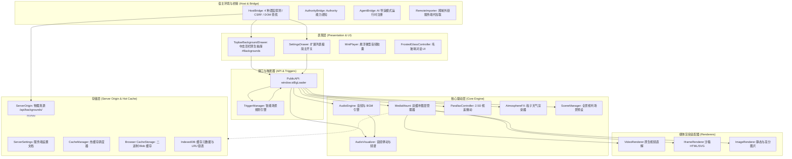

# Architecture & Design (系统架构与解耦设计)

ST-BgLoader 遵循现代高内聚、低耦合的模块化设计哲学。所有扩展子系统（天气、视觉律动、景深视差、智能触发器、音频隔音滤波）皆设计为**即插即用、相互隔离的自洽独立系统**。

---

## 🏗️ 核心架构全景图



---

## ⚡ 绝对解耦与零负载保证 (Zero-Cost Abstraction)

在浏览器前端运行富媒体及粒子动效时，CPU/GPU 资源的节制性至关重要。ST-BgLoader 实现了严格的**按需运行与绝对零开销原则**：

1. **天气粒子系统 (`AtmosphereFX`)**：
   - 当 `weather.type === 'off'` 时，粒子模拟循环完全停止（调用 `cancelAnimationFrame`），Canvas 设为 `display: none` 并立即清空上下文，卸载全部粒子数组与涟漪队列。
   - **空闲 CPU 消耗：0.00%**。
2. **音频频谱与低音律动 (`AudioVisualizer`)**：
   - 当 `visualizer.mode === 'off'` 时，禁用频率采样，终止逐帧绘制，重置主背景缩放变换与明暗滤镜。
   - **空闲 CPU 消耗：0.00%**。
3. **2.5D 景深视差 (`ParallaxController`)**：
   - 当 `parallax.enabled === false` 时，移除全局 `window.mousemove` 监听器，中断弹簧阻尼 Lerp 插值循环，重置主容器 CSS `transform`。
   - **空闲 CPU 消耗：0.00%**。
4. **隔壁房间声学模拟 (`AudioEngine`)**：
   - 当 `muffleBGM === false` 时，Biquad 滤波器直接恢复 20,000 Hz 全通状态，不破坏直解管线。

---

## 🔄 双缓冲无缝淡入淡出与重入锁保护

为了在切换 4K 视频、HTML5 动效或高清大图时彻底消除白屏、闪烁或黑边，ST-BgLoader 采用了**图层 A/B 双缓冲机制 (Double-Buffering)**：

```
[Layer A]  (Active, Opacity: 1)  ------>  (Fading Out, Opacity: 0)  ------> Destroy
                                                 \
                                                  \ (Crossfade: 400ms)
                                                   v
[Layer B]  (Pre-mounted, Opacity: 0) --> (Fading In, Opacity: 1)   ------> Active
```

### 极限重入锁保护 (`crossfadeTimer`)
在极端情况下（例如用户快速连击不同的媒体卡片，或自动化脚本在 100ms 内发起 10 次切换请求）：
- 系统会在每次挂载新媒体前，立即检查并清除尚未完成的 `crossfadeTimer`；
- 瞬间销毁废弃图层的视频流或 Iframe 实例，将旧图层透明度强制归零；
- 保证整个 DOM 树中有且仅有 1 个激活图层与 1 个待过渡图层，彻底避免内存泄漏与多重音画叠加。

---

## 🎛️ WebAudio 信号图谱 (Audio Signal Pipeline)

```
[HTMLAudioElement / Video Source]
        │ (crossOrigin = "anonymous")
        ▼
[MediaElementAudioSourceNode]
        │
        ▼
[BiquadFilterNode (LowPass)]  <--- setMuffled(true: 800Hz / false: 20000Hz)
        │
        ▼
[AnalyserNode (FFT: 256)]     ---> AudioVisualizer (Pulse energy / Spectrum bars)
        │
        ▼
[AudioContext.destination]   ---> 硬件扬声器 / 耳机
```

1. **手势前置安全守卫**：浏览器普遍阻止未产生交互前的 AudioContext 自动发声。系统监听首次用户交互（`pointerdown`, `keydown`, `touchstart`），无缝唤醒 AudioContext 并平滑拉起音量（400ms 淡入），避免控制台报错。
2. **Lo-Fi 声学模拟**：采用二阶低通滤波器（`lowpass`，Q 值 1.0）。开启隔壁房间模式时，截止频率在 80ms 内指数过渡至 800Hz，滤除高频音质，呈现逼真的隔墙沉浸声。

---

## 💾 存储体系：服务端同源真源与客户端热缓存

ST-BgLoader 的存储架构区分「持久化真源」与「前端临时缓存」：

1. **服务端物理目录 (`ServerOrigin`，唯一真源)**：
   - 所有上传、导入的背景媒体（视频、音频、图片、网页）均持久化在酒馆服务端的 `backgrounds/` 物理目录，通过 `/api/backgrounds/` 读写。
   - 配置真源存储在服务端文档 `st-bg-loader-settings.json`（`ServerSettings`）。
   - 用户清空浏览器数据或更换设备时，服务端资产完好无损。
2. **客户端临时热缓存 (`CacheManager`)**：
   - **`CacheStorage`**：临时保存常用大视频/音频/沙箱二进制流，利用浏览器底层流式 I/O 避免重复网络请求与 JavaScript 堆占用。
   - **`IndexedDB` (`st_bgloader_db`)**：维护热缓存元数据与 LRU 访问链表，按配额自动清理最久未访问的临时缓存。
   - 客户端缓存随时可重建，不承担持久化真源职责。

---

## 📦 全模块清单与代码组织 (`src/`)

| 目录 / 文件 | 核心职责 | 协作与调用关系 |
| :--- | :--- | :--- |
| `src/bridge/HostBridge.ts` | 跨 4 宿主（SillyTavern/Luker/PureTavern/TauriTavern）环境探测、DOM 查找与 CSRF 头提取 | 被 `index.ts`、`ServerOrigin.ts`、`SettingsDrawer.ts` 调用 |
| `src/ui/TopbarBackgroundDrawer.ts` | 夺舍顶栏 `#Backgrounds` 原生抽屉，提供 Tab 1 媒体库与 Tab 2 详细设置 | 被 `index.ts` 装配，直接与宿主顶栏按钮联动 |
| `src/ui/SettingsDrawer.ts` | 扩展设置列表面板极简卡片：单主开关、状态提示与直达抽屉按钮 | 注入宿主 `#extensions_settings` 面板 |
| `src/ui/MiniPlayer.ts` | 悬浮音乐微型胶囊控制器（显隐、切歌、模式、智能退隐） | 监听 `AudioEngine` 与 `PublicAPI` |
| `src/ui/FrostedGlassController.ts` | 毛玻璃通透对话界面渲染控制器 | 直接操作宿主聊天消息容器 CSS |
| `src/ui/NativeBackgroundController.ts` | 原生背景选择器的辅助感知与状态标记 | 与原生 DOM 事件配合 |
| `src/ui/style.css` | 扩展全局样式表（双前缀类名，继承 `--SmartTheme*`，无溢光阴影） | 由构建工具注入宿主 `<head>` |
| `src/backend/ServerOrigin.ts` | 服务端 `/api/backgrounds/` 物理媒体文件增删查改与 TTL 缓存 | 底层存储真源通道 |
| `src/backend/ServerSettings.ts` | 服务端 `st-bg-loader-settings.json` 配置文件读写与版本收敛 | 设置持久化真源 |
| `src/backend/SettingsSync.ts` | Authority KV 跨设备镜像同步（回退与补充） | 与 Authority 通信 |
| `src/backend/AuthorityBridge.ts` | Authority 扩展特性感知（SDK 探测、状态事件与静默降级） | 对外暴露能力集 |
| `src/backend/AgentBridge.ts` | AI 导演模式工具集向 Agent Runtime 注册 | 受 `agentToolsEnabled` 开关门控 |
| `src/backend/RemoteImporter.ts` | 跨域受阻外链媒体的服务端代拉取导入通道 | Authority 服务端代下载 |
| `src/core/MediaMount.ts` | 双缓冲图层管理器（图层 A/B、转场动画、对齐方式、滤镜挂载） | 视听图层核心挂载点 |
| `src/core/ParallaxController.ts` | 2.5D 视差动效控制器（陀螺仪与鼠标位移监听） | 变换 `#st-bg-layer-container` |
| `src/core/SceneManager.ts` | 全景视听场景快照管理器（内置场景与用户自定义场景） | 批量应用全套视听参数 |
| `src/core/mediaType.ts` | 媒体类型判定工具（根据 MIME、扩展名与流探测） | 全局共享判定真源 |
| `src/core/sanitize.ts` | 字符串安全转义共享工具 | XSS 防御 |
| `src/cache/CacheManager.ts` | 客户端热缓存管理器（CacheStorage + IndexedDB LRU 链表） | 充当大文件加速通道 |
| `src/renderers/VideoRenderer.ts` | `<video>` 视频直解渲染器（自动播放解码策略） | 由 `MediaMount` 调度 |
| `src/renderers/ImageRenderer.ts` | `` 静态高分图片渲染器 | 由 `MediaMount` 调度 |
| `src/renderers/IframeRenderer.ts` | `<iframe>` HTML5/SVG 安全沙箱渲染器 | 由 `MediaMount` 调度 |
| `src/audio/AudioEngine.ts` | WebAudio BGM 播放器与低通隔音滤波器 | 驱动全局音频管道 |
| `src/audio/AmbientSoundGenerator.ts`| 程序化白噪音发生器（雨声/柴火/风声） | 基于 WebAudio 节点程序化合成 |
| `src/fx/AtmosphereFX.ts` | Canvas 环境粒子与天气效果（雨/雪/樱花/微粒/扫描线） | 顶层动效覆盖层 |
| `src/visualizer/AudioVisualizer.ts` | 音频频谱与低音律动可视化控制器 | 读取 `AudioEngine` 分析节点 |
| `src/triggers/TriggerManager.ts` | 智能自动化场景触发器引擎（角色/聊天/正则匹配） | 监听宿主聊天更新事件 |
| `src/types/index.ts` | 全局 TypeScript 类型定义与默认配置集合 | 契约与常量真源 |
| `src/api/PublicAPI.ts` | `window.stBgLoader` 公开编程接口与事件总线 | 对外公开接口总线 |
| `src/index.ts` | 扩展入口与主生命周期装配点 | 初始化与各子系统调度中心 |

