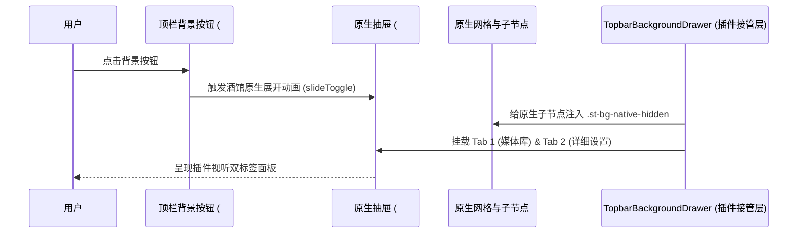

# 顶栏原生抽屉夺舍与跨宿主集成 (Native Background Integration)

> 本文档详细阐述 ST-BgLoader 对 4 种酒馆顶栏背景抽屉的原位接管（夺舍）机制、单开关极简设置面板以及跨宿主兼容架构。

---

## 1. 架构目标：从外挂插件到原生原位融合

传统第三方扩展通常在酒馆界面的扩展列表（`#extensions_settings`）里塞入大量冗长的设置表单，这割裂了用户的视觉体验与操作链路。
ST-BgLoader 采用「**顶栏背景抽屉原位夺舍 (Takeover)**」的革新设计：
1. **顶栏原位展开**：点击酒馆顶栏自带的「背景设置」按钮时，直接展开原生的 `#Backgrounds` 抽屉，但其内部已经被插件替换为全新的功能容器。
2. **双标签页架构**：
   - **Tab 1「背景媒体库」**：直接展示与管理服务端 `/api/backgrounds/` 物理目录中的背景资源，支持文件上传、外链 URL 导入、实时搜索与类型筛选；
   - **Tab 2「详细设置」**：集成视听滤镜与调色、环境天气、音频频谱、3D视差、BGM与环境音、全景预设、转场、毛玻璃与缓存管理等全套功能。
3. **扩展列表极简化**：在酒馆原生的 `#extensions_settings` 扩展列表中，仅保留一个**主总开关**、状态摘要和「打开背景与详细设置」便捷直达按钮，视觉整洁度达到 100%。

---

## 2. 夺舍与接管实现机制 (`TopbarBackgroundDrawer`)



### 2.1 原生节点无损隐藏与还原
- 插件在 `#Backgrounds` 容器中注入带有双前缀类名 `.st-bg-topbar-panel` 的接管面板。
- 原生抽屉原有的子节点（如原生背景网格、原生输入框等）被自动赋予 `.st-bg-native-hidden` 类名（通过 CSS 进行 `display: none !important;` 隐藏）。
- **无损退出与降级**：插件绝对不会通过 `node.remove()` 破坏原生 DOM。当用户在设置中关闭「主总开关」时，插件仅需卸载接管容器并移除 `.st-bg-native-hidden`，酒馆原生背景网格瞬间、零延迟、完好无损地恢复原貌。

### 2.2 遵循原生动画与折叠纪律
- 绝不给 `.inline-drawer-toggle` 单独绑定自己的点击事件，避免与宿主基于 jQuery 的全局委托事件产生竞态导致抽屉卡死。
- 绝不在原生抽屉容器上直接写入 `display: flex` 或内联样式，完全借用宿主的 `slideToggle()` 动画与手势交互。

---

## 3. 扩展设置列表面板极简化 (`SettingsDrawer`)

在酒馆「扩展设置」面板中，ST-BgLoader 遵循极简原则，呈现如下卡片：

```
┌─────────────────────────────────────────────────────────┐
│ 🎬 背景加载与多媒体增强 (ST-BgLoader)                     │
├─────────────────────────────────────────────────────────┤
│ [√] 启用背景加载与顶栏接管                               │
│                                                         │
│ 状态: 已激活背景 (neon_city.mp4)                        │
│ 提示: 插件已原位接管顶栏背景设置抽屉。                   │
│                                                         │
│ [ 🎨 打开背景与详细设置 ]                               │
└─────────────────────────────────────────────────────────┘
```

- **[√] 启用背景加载与顶栏接管 (`st_bg_master_enable`)**：主总开关。关闭时完全释放对顶栏抽屉的接管，还原原生行为。
- **状态徽章**：实时显示当前正在展示的背景媒体名称与状态。
- **「打开背景与详细设置」按钮**：点击直接调用 `HostBridge.openBackgroundDrawer()`，自动平滑呼出顶栏抽屉，一键直达详细配置。

---

## 4. 跨 4 种酒馆环境适配 (`HostBridge`)

ST-BgLoader 针对四大主流酒馆平台进行了深度环境感知与统一抹平：

| 宿主平台 | 探测标识 | 顶栏按钮 DOM | 背景抽屉 DOM | CSRF 与网络特征 |
| --- | --- | --- | --- | --- |
| **SillyTavern** | `window.SillyTavern` / 上下文特征 | `#backgrounds-button` | `#Backgrounds` | 标准酒馆 CSRF 请求头 |
| **Luker** | 仓版本与 Luker 特征 | `#backgrounds-button` | `#Backgrounds` | 严格继承原生主题变量 |
| **PureTavern** | `window.__PURE_TAVERN__` | `#backgrounds-drawer-toggle` | `#bg_menu_content` / 抽屉 | 纯前端/远程后端解耦 |
| **TauriTavern** | `window.Tauri` / `__TAURI__` | 原生顶栏选择器 | 原生容器选择器 | 原生应用安全沙箱环境 |

所有宿主探测与适配逻辑均完全收敛在 [`src/bridge/HostBridge.ts`](file:///d:/Repo/Tavern-repo/My-repo/ST-BgLoader/src/bridge/HostBridge.ts) 模块内，杜绝在业务代码中散落 `if (isLuker)` 类的脏逻辑。

---

## 5. 原生视觉规范：零溢光原则

1. **绝对禁止 `box-shadow` 溢光**：整个插件样式表严禁出现任何 `box-shadow` 外发光按钮或卡片特效（`grep -c 'box-shadow:' src/ui/style.css` 严格为 0）。所有卡片的边界感与层次感均通过精致的 1px/2px 实线边框 (`border`) 与透明度混合对比来表达。
2. **全面继承 `--SmartTheme*`**：背景色、文字颜色、边框颜色、引用高亮色均继承自酒馆原生 CSS 变量，完美契合用户的深色、浅色或自定义主题。
