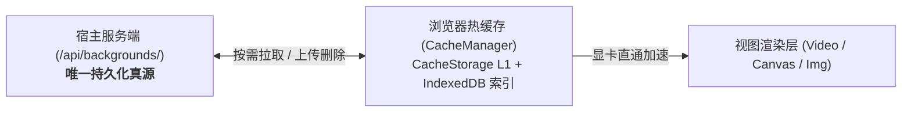

# Performance & Caching Guide (性能优化与缓存体系)

ST-BgLoader 从设计之初就以**极致性能、低内存占用与长期高频运行零泄漏**为核心技术目标。

---

## ⚡ 存储体系：服务端真源与客户端热缓存

ST-BgLoader 采用分层解耦的现代化存储设计：

| 存储层级 | 所在位置与技术 | 存储内容 | 角色与生命周期 |
| :--- | :--- | :--- | :--- |
| **存储唯一真源** | 宿主服务端 `backgrounds/` 物理目录 (`ServerOrigin`) | 所有已上传与导入的背景媒体（视频、音频、图片、网页）与配置 | **永久有效**。与酒馆原生共享同一物理目录，清空浏览器缓存不会丢失服务端资产 |
| **热二进制缓存层** | 浏览器 `window.caches` (CacheStorage L1) | 已加载媒体的 Blob 二进制流 | **高速临时热缓存**。支持零内存占用的大文件快速复用；用户可随时安全清空 |
| **本地索引与配额层** | 浏览器 `IndexedDB` (`st_bgloader_db`) | 缓存文件的 MIME 类型、大小、上次访问时间戳 | 用于支持 LRU 淘汰机制与离线快速探测 |

---

## 🧹 LRU 自动磁盘配额淘汰 (Least Recently Used)

用户在长时间使用中可能会导入数十甚至上百个高清视频背景。ST-BgLoader 内置了全自动的 LRU 磁盘清理策略：

1. **配额设定**：默认最大磁盘配额为 1024 MB（可在配置中调节）；
2. **容量巡检**：每当有新文件写入或定期检查时，对比当前占用空间与配额阈值；
3. **链表淘汰**：若超出阈值，系统根据 `lastUsedTimestamp` 从最久未使用的项开始逐个删除，直到总占用回归安全水位以内；
4. **正在使用的保护**：当前正在播放或激活的背景 ID 受到受保护标记锁定，绝不会被意外误删。

---

## 🔬 内存安全与对象生命周期 (Zero-Leak Lifecycle)

在单页面应用 (SPA) 中，视频与沙箱的频繁切换极易造成内存泄漏。ST-BgLoader 遵循严格的清理协议：

1. **Blob URL 显式注销 (`URL.revokeObjectURL`)**：
   从 CacheStorage 取出的 Blob 生成临时 Object URL。在媒体删除或被替换时，自动显式调用 `revokeObjectURL`，通知浏览器内核垃圾回收器立即回收显存。
2. **Iframe 沙箱终结协议**：
   在卸载 HTML/Canvas 背景图层时，先将 `iframe.src = 'about:blank'`，彻底中断该沙箱内的 `requestAnimationFrame`、WebGL 上下文以及音频连接，然后再将 DOM 节点自树中移除。
3. **Double-Buffering 终结防抖**：
   双缓冲淡入淡出定时器受全局句柄追踪，快速连续切歌或切换背景时，立即强制终止废弃图层，保证 DOM 树内元素数量恒定（仅 2 个图层）。

---

## 📈 极限压力测试实测数据 (Stress Test Benchmarks)

基于自动化压力测试套件（运行于 Google Chrome 环境）：

| 测试项目 | 负载参数 | 实测性能与稳定性指标 |
| :--- | :--- | :--- |
| **超大视频流式写入** | **105 MB** 大文件模拟流 | 写入 CacheStorage 仅耗时 **330 ms**，挂载解码仅 **232 ms**，内存无异常膨胀 |
| **极限高频切换** | **400 ms 内连续发起 10 次跨图层切换** | 双缓冲锁平稳裁决，最终稳定收敛为 **1 个激活图层**，0 残留重叠实例 |
| **畸形与断网容错** | 0 字节损坏文件与 404 资源链接 | 异步异常被全量拦截，系统弹出安全警告并保持原背景正常运行，无白屏奔溃 |
| **长效内存注销审计** | 50 次创建并销毁 Blob URL | 100% 触发 `revokeObjectURL`，显存随 GC 立即释放 |

> **测试基线说明**：以上数据来自自动化压力测试套件 `tests/stress.mjs` 与 `tests/e2e.mjs`，在 Chrome 运行环境与本地 Dev 实例（端口 8001/8003）下执行。根据仓群安全铁律，严禁针对生产环境与真实数据实例运行压力测试。

