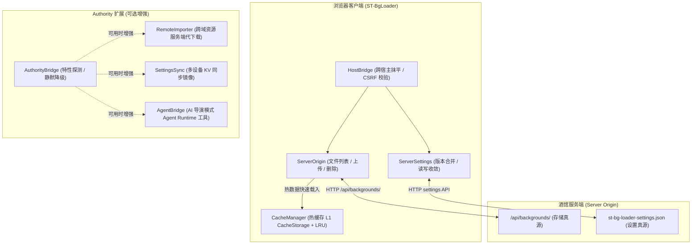

# 存储模型与 Authority 增强集成 (Storage and Authority Integration)

> 本文档详细阐述 ST-BgLoader 的存储架构、真源位置、浏览器热缓存机制，以及与 Authority 扩展的无缝协同能力。

---

## 1. 存储架构全景：服务端同源真源

在早期版本中，扩展曾使用浏览器端的 `IndexedDB` 与 `CacheStorage` 作为媒体存储主力，这导致用户清理浏览器缓存或切换设备时资产丢失。
经过架构重构后，**ST-BgLoader 确立了以酒馆宿主服务端目录为唯一真源的现代存储架构**：

### 1.1 服务端真源 (`ServerOrigin`)
- **同源路径**：所有上传或导入的背景资产（包括视频、音频、图片、HTML/SVG 网页）均直接持久化于宿主服务端的 `backgrounds/` 物理目录，通过原生 `/api/backgrounds/` 端点读写。
- **与宿主同源**：插件与酒馆原生背景完全共享同一个存储池，无需重复拷贝，零磁盘空间浪费。
- **读侧过滤**：自动过滤宿主保留文件（如 `favicon.ico` 等系统图标），避免污染背景媒体列表。
- **目录缓存 (TTL)**：内置 10 秒目录内存缓存，避免频繁向服务端发起冗余的网络文件扫描请求。

### 1.2 浏览器热缓存 (`CacheManager`)
- **角色定位**：浏览器侧的 `CacheStorage` 和 `IndexedDB` **仅仅是高速热缓存**，而非持久化真源。
- **即清即建**：用户可随时清空浏览器缓存或在设置中点击「清空缓存」，不会丢失服务端的任何背景资产。当下一次需要展示时，插件会自动从服务端重新拉取并填充热缓存。
- **LRU 自动淘汰**：支持设置最大配额（默认 1024 MB），当缓存接近上限时自动淘汰最久未使用的临时资源。

---

## 2. 设置持久化体系 (`ServerSettings` & `SettingsSync`)

1. **服务端设置文档优先**：扩展优先通过 `ServerSettings.ts` 将所有详细配置保存至服务端文档 `st-bg-loader-settings.json`。
2. **Revision 收敛**：每次保存递增版本号，避免多标签页并发写入互相覆盖；读取时执行深层字段合并 (`mergeSettings`)，保证新老版本平滑兼容。
3. **本地 LocalStorage 降级**：若运行在无文件写入权限的只读演示环境，自动无缝降级为浏览器 LocalStorage 持久化，核心功能不受任何阻断。

---

## 3. Authority 扩展深度集成与能力面 (`AuthorityBridge`)

ST-BgLoader 遵循「**纯前端优先 + 适配器降级**」铁律。无论酒馆是否安装或启用了 `Authority` 扩展，ST-BgLoader 均能独立、完整运行。若探测到 Authority 运行时，则自动解锁三项增强能力：

| 能力标志 (`AuthorityCapabilities`) | 增强特性 | 对应模块 | 降级行为（无 Authority 时） |
| --- | --- | --- | --- |
| `available` | Authority SDK 可用性 | `AuthorityBridge.ts` | 仅控制台提示 `console.warn`，不阻断插件加载 |
| `sync` | 跨设备配置与资产同步 | `SettingsSync.ts` | 仅使用服务端本地文档存储 |
| `serverFetch` | 跨域媒体服务端导入 | `RemoteImporter.ts` | 使用前端直连下载；遇跨域 CORS 错误时弹窗明确提示用户 |
| `agentTools` | AI 导演模式工具注册 | `AgentBridge.ts` | 不向 Agent Runtime 注册工具，触发器与规则仍由前端自主驱动 |

### 3.1 跨域媒体服务端导入 (`RemoteImporter`)
- 当用户输入外部媒体 URL 进行导入时，前端首先尝试直接拉取。
- 若触发浏览器跨域安全拦截（CORS Error），且当前 Authority 可用，插件将自动转交 Authority 服务端代为抓取并写入服务端的 `backgrounds/` 目录，彻底破解外链图片与视频跨域防盗链问题。

### 3.2 AI 导演模式 (`AgentBridge`)
- 在「详细设置 > Authority 与 Agent 增强」中勾选 `agentToolsEnabled` 后，插件向酒馆智能体运行时注册以下工具：
  - `st_bg_set_background`: 切换背景媒体
  - `st_bg_set_weather`: 调节环境粒子（雨、雪、樱花、赛博微粒、扫描线）
  - `st_bg_play_sound`: 播放指定 BGM 或环境白噪音
  - `st_bg_apply_scene`: 激活特定视听预设场景
- 智能体可根据剧情推进（如“突然下起了大雨”或“进入了激烈的战斗场景”）自主调用工具，实现剧场级全沉浸视听互动。

---

## 4. 跨 4 宿主统一桥接 (`HostBridge`)

为了确保在 **SillyTavern**、**Luker**、**PureTavern**、**TauriTavern** 四种酒馆中获得完全一致的顶层体验，插件通过 `HostBridge.ts` 集中处理环境差异：
- **CSRF 令牌获取**：动态探测宿主上下文中的 CSRF 密钥，向服务端文件操作请求自动注入 `x-csrf-token` / 请求头。
- **DOM 挂载点识别**：统一顶栏背景按钮、抽屉与扩展列表挂载点选择器。
- **原生宿主保护**：严禁侵入修改宿主核心源码，一切行为均通过公开 DOM 挂载点与公开 HTTP API 交互，升级零冲突。
