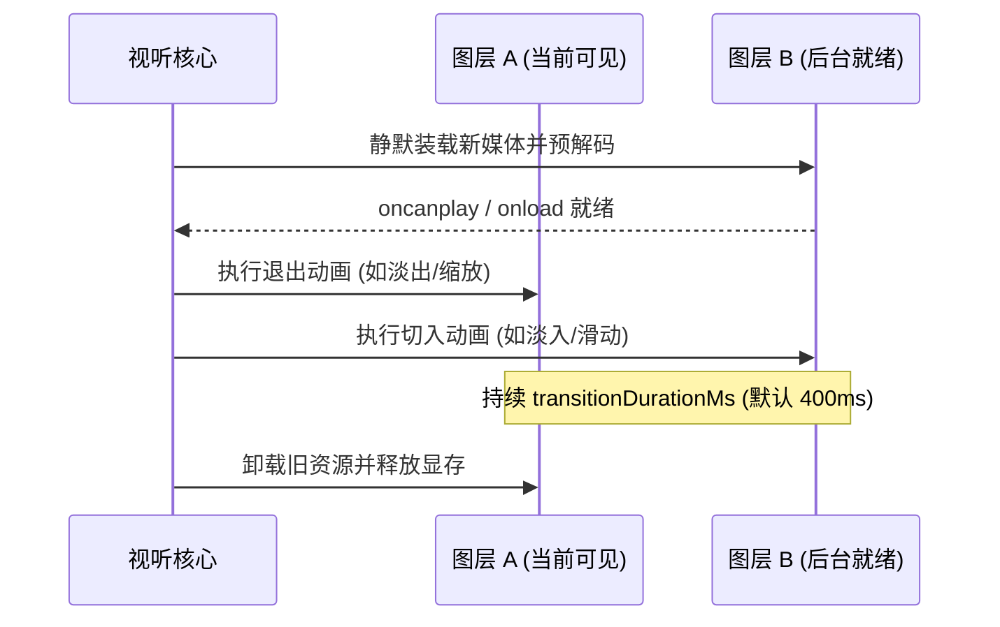

# UI 组件、视听转场与毛玻璃 (UI Components and Transitions)

> 本文档详细阐述 ST-BgLoader 提供的微型 UI 交互组件、双缓冲视听转场引擎以及毛玻璃通透对话界面。

---

## 1. 迷你音乐胶囊播放器 (`MiniPlayer`)

为了在不打断用户阅读与角色对话的前提下提供沉浸式音频控制，ST-BgLoader 内置了悬浮在屏幕右下角的小型音乐胶囊播放器。

```
┌──────────────────────────────────────────────┐
│ 🎵 [Cyber_Rain.mp3]   ⏮  ▶  ⏭  🔁  ×        │
└──────────────────────────────────────────────┘
```

### 1.1 核心特性
- **微交互控件**：支持「播放/暂停」、「上一首」、「下一首」、「播放模式切换（单曲/列表/随机）」与「快速最小化」。
- **动态音浪律动**：胶囊内置微型 CSS 音浪波纹指示器，随当前音频播放节奏同步呼吸跳动。
- **智能退隐模式 (`capsuleOnPlayOnly`)**：
  - 默认开启；当音频播放器处于空闲（Stopped）或静音状态时，迷你胶囊会自动优雅淡出并隐藏，零遮挡对话区；
  - 一旦触发剧情 BGM 或用户手动切歌，胶囊自动滑入展开。

---

## 2. 毛玻璃对话框 UI (`FrostedGlassController`)

在传统背景插件中，深色或不透明的聊天框往往彻底挡住了精彩的动态视频或全景壁纸。ST-BgLoader 提供了原生级的毛玻璃通透对话框增强：

- **实现原理**：通过安全注入带有硬件加速的 CSS `backdrop-filter: blur(...)` 与计算透明背景，将酒馆的核心对话消息区域转化为半透明水晶质感。
- **核心参数**：
  - **启用开关 (`frostedChat.enabled`)**：一键开启或关闭毛玻璃效果。
  - **模糊半径 (`frostedChat.blur`)**：0 到 20px，控制背景虚化程度。
  - **背景不透明度 (`frostedChat.opacity`)**：10% 到 100%，平衡文字可读性与背景通透度。
- **自适应暗色/亮色对比**：自动感知文字色彩对比度，即使背景极度明亮或快速运动，文字依旧清晰锋利，不发生眩光与视觉疲劳。

---

## 3. 双缓冲视听转场引擎 (`MediaMount`)

在切换背景（尤其是 4K 视频、HTML5 动态壁纸或大图）时，若直接替换 DOM，往往会出现瞬时白屏或黑屏闪烁。ST-BgLoader 设计了**双缓冲图层渲染机制**：



### 3.1 五种转场动画效果 (`TransitionType`)

| 效果标识 (`TransitionType`) | 名称 | 视觉特征与应用场景 |
| --- | --- | --- |
| `fade` | 经典淡入淡出 (Cross-Fade) | 两层透明度线性平滑交叉过渡，自然无感，适合绝大多数静态图与氛围切换 |
| `zoom_fade` | 镜头推进缩放淡入 (Zoom Fade) | 新背景以 1.05 倍微放大逐渐淡入并回缩至 1.0，产生电影镜头推进的临场感 |
| `blur_fade` | 径向虚化淡入 (Blur Fade) | 新背景从径向高斯模糊状态中逐渐剥离出清晰细节，梦幻且柔和 |
| `slide_left` | 向左滑动推进 (Slide Left) | 新背景从右侧推入、旧背景向左滑出，适合横向场景转换与多幕剧场切换 |
| `slide_right` | 向右滑动推进 (Slide Right) | 新背景从左侧推入、旧背景向右滑出 |

- **转场时长 (`transitionDurationMs`)**：默认为 400 毫秒，支持在 100ms ~ 2000ms 之间微调，达到最舒适的过渡节奏。

---

## 4. 快捷键的历史与替代入口说明

在旧版（早期试验版本）中，插件曾尝试注册 `Alt+B`（切换背景显隐）、`Alt+F`（切换滤镜）、`Alt+M`（静音）等全局键盘快捷键。

### 为什么移除了快捷键？
1. **浏览器系统按键冲突**：在主流 Chromium 浏览器中，`Alt+F` 是打开浏览器右上角主菜单的硬编码系统加速键，导致用户按键时菜单反复弹跳，严重破坏操作体验。
2. **多操作系统与 IME 冲突**：Windows 系统的输入法与部分桌面环境将 `Ctrl+Alt` 系列视为保留热键，容易引发误触或按键被拦截。

### 现在的现代化替代入口：
- **顶栏原生背景抽屉**：点击酒馆顶栏背景按钮，原位呈现全套背景管理与调色、天气选项。
- **浮动迷你音乐胶囊**：屏幕右下角点击即可随心控制切歌、循环与静音。
- **扩展设置极简面板**：在 `#extensions_settings` 一键直达顶栏抽屉。
- **公开编程 API (`window.stBgLoader`)**：开发者或脚本工具可通过控制台或第三方自动化脚本自由调用全部功能。
